# Closed-Loop BLDC Motor Drive with Hall-Based Six-Step Commutation

MATLAB/Simulink simulation of a brushless DC motor drive: Hall-sensor six-step (120°) commutation, a 20 kHz PWM three-phase MOSFET inverter and a discrete PI speed controller with output limits and back-calculation anti-windup. The model is generated by a script, every parameter lives in one file, and a single command runs four test scenarios, computes transient-response metrics, checks the commutation logic and produces the figures.

This is a simulation project. It contains no hardware implementation or experimental validation. All results below were produced with MATLAB R2025a (Simulink, Simscape Electrical – Specialized Power Systems).

---

## System Architecture

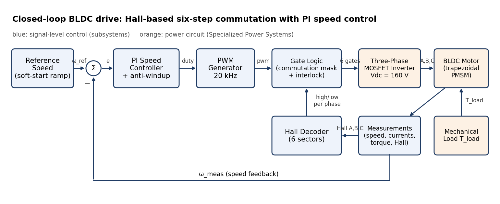

```
Speed reference (soft-start ramp)
   → PI speed controller (duty command, 0…1, anti-windup)
   → PWM generator (20 kHz triangular carrier)
   → Gate logic: Hall-based commutation mask + leg interlock
   → Three-phase MOSFET inverter (Vdc = 160 V)
   → BLDC motor (trapezoidal-flux PMSM block)
   → Measurements → speed feedback
```

Top level of `BLDC_ClosedLoop.slx`:

| Subsystem | Content |
|---|---|
| Reference Speed | Two-step reference profile and a rate limiter (soft start) → `omega_ref_rpm` |
| Speed Controller | rpm → rad/s, speed sampling at 10 kHz, discrete PI, saturation, anti-windup → `duty_cmd` |
| Commutation Logic | Hall Decoder, PWM Generator, Gate Logic (interlock) → `gate_cmd` = [AH AL BH BL CH CL] |
| Three-Phase Inverter | Ideal DC link, Universal Bridge (MOSFET/diode), DC-link voltage measurement |
| BLDC Motor | Permanent Magnet Synchronous Machine block, trapezoidal back-EMF, 120° flat top |
| Mechanical Load | Base load + load-torque step → `T_load` |
| Measurements | Machine bus → `omega_meas_rpm`, `Hall_A/B/C`, `i_a/b/c`, `T_e` |
| Performance Monitoring | Scopes for speed, torque, currents, duty and DC-link voltage |

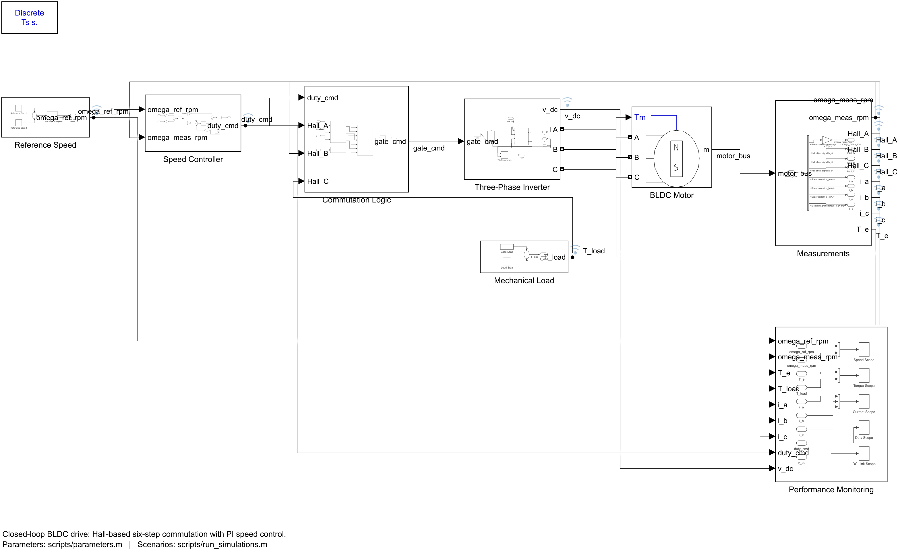

*Top-level implementation of the closed-loop BLDC drive in Simulink.*

All important signals are logged with Simulink signal logging (`logsout`, `Simulink.SimulationData.Dataset`); fast analog signals are decimated to 10 µs and the gate signals are logged at 1 µs so the 20 kHz PWM remains visible.

---

## BLDC Motor Model

The motor is the Specialized Power Systems *Permanent Magnet Synchronous Machine* block with **trapezoidal flux distribution** (120° flat back-EMF), which is the standard way to model a BLDC machine in this library.

Per phase (star connection, neutral not accessible):

$$v_x = R_s i_x + L_s \frac{di_x}{dt} + e_x + v_n, \qquad e_x = p\,\lambda\,\omega_m\,f_x(\theta_e)$$

where $f_x$ is the trapezoidal shape function (±1 on the flat parts). Mechanical side:

$$J\frac{d\omega_m}{dt} = T_e - T_L - B\,\omega_m, \qquad T_e = p\,\lambda \sum_x f_x(\theta_e)\, i_x$$

With two phases conducting a current $I$, $T_e = K_t I$ with $K_t = 2p\lambda$, and the line-to-line back-EMF is $K_e\,\omega_m$ with $K_e = 2p\lambda$.

| Parameter | Symbol | Value |
|---|---|---|
| Phase resistance | $R_s$ | 0.7 Ω |
| Phase inductance | $L_s$ | 2.72 mH |
| Magnet flux linkage | $\lambda$ | 0.105 V·s |
| Pole pairs | $p$ | 4 |
| Back-EMF flat top | – | 120° |
| Rotor inertia | $J$ | 0.8×10⁻³ kg·m² |
| Viscous friction | $B$ | 1×10⁻³ N·m·s |
| Torque constant (2 phases) | $K_t$ | 0.84 N·m/A |
| Line-line back-EMF constant | $K_e$ | 0.84 V/(rad/s) ≈ 88 V/krpm |
| DC-link voltage | $V_{dc}$ | 160 V |

No rated power, current or speed is defined for this machine, so none is claimed. At 1500 rpm the line-line back-EMF is about 132 V; the 160 V DC link leaves roughly 20 % voltage headroom for acceleration and load. The DC link is an ideal voltage source (no rectifier or capacitor is modelled).

---

## Hall-Based Six-Step Commutation

Each Hall pair gives a phase command $c_x \in \{-1, 0, +1\}$:

$$c_a = H_A - H_B, \qquad c_b = H_B - H_C, \qquad c_c = H_C - H_A$$

$c_x = +1$ selects the upper switch of phase *x*, $c_x = -1$ the lower switch, and $c_x = 0$ leaves the phase floating. In every sector exactly one upper and one lower switch conduct, each for 120° electrical.

| Sector | Hall A B C | State | $c_a$ $c_b$ $c_c$ | Upper switch (PWM) | Lower switch (on) | Current path |
|:---:|:---:|:---:|:---:|:---:|:---:|:---:|
| 1 | 1 0 1 | 5 | +1 −1 0 | AH | BL | A → B |
| 2 | 1 0 0 | 4 | +1 0 −1 | AH | CL | A → C |
| 3 | 1 1 0 | 6 | 0 +1 −1 | BH | CL | B → C |
| 4 | 0 1 0 | 2 | −1 +1 0 | BH | AL | B → A |
| 5 | 0 1 1 | 3 | −1 0 +1 | CH | AL | C → A |
| 6 | 0 0 1 | 1 | 0 −1 +1 | CH | BL | C → B |
| – | 0 0 0 / 1 1 1 | 0 / 7 | 0 0 0 | none | none | all switches off |

The sectors are listed in the order they occur for forward (positive-speed) rotation: the energized pair advances AB → AC → BC → BA → CA → CB, which is the positive sequence for phase order a-b-c. `run_simulations.m` checks from the logged Hall signals that the state sequence really is 5-4-6-2-3-1 with no skipped or reversed steps (Fig. 4 shows one electrical period: … 2 → 3 → 1 → 5 → 4 → 6 …).

**PWM scheme.** The duty command modulates only the upper switch of the active sector; the lower switch stays on for the whole 60° sector (high-side chopping). During the PWM off-time the phase current freewheels through the lower diode of the chopped leg.

**Gate interlock.** The decoder already makes the high and low commands of one leg mutually exclusive. The gate logic adds an explicit interlock anyway:

```
Gate_xH = high_x AND pwm AND NOT low_x
Gate_xL = low_x  AND NOT high_x
```

The illegal Hall states 000 and 111 turn every switch off. Dead time is not modelled because the switches are ideal and the interlock prevents simultaneous commands.

**How the commutation chain was verified.**

1. *Gate-vector order.* The order of the six gate inputs of the Universal Bridge was checked on a separate test bench (Universal Bridge with MOSFET/diodes, 100 V DC, star-connected 10 Ω resistors). Gates 1 and 4 on gave $i_a = +5$ A and $i_b = -5$ A, gates 1 and 6 gave $i_a = +5$ A and $i_c = -5$ A, and so on. This confirms the order `[AH AL BH BL CH CL]` that the gate logic produces. The check is reproducible with `scripts/verify_gate_mapping.m`: the script programmatically builds this temporary resistive-load Universal Bridge test bench in MATLAB R2025a (same bridge settings as the drive model), switches on every pair of gate elements, derives from the measured phase voltages and currents which element drives which switch, and reports PASS/FAIL for the expected order `[AH AL BH BL CH CL]`. The temporary model is closed without saving.
2. *Direction.* With a positive speed reference the rotor accelerates forward and the Hall states follow 5-4-6-2-3-1.
3. *Alignment.* If the decoder energised the wrong pair of phases, the motor would still turn, but with less torque per ampere. In Test 2 the measured ratio of mean torque to conducting-pair current is close to the theoretical $K_t = 2p\lambda = 0.84$ N·m/A (see the results table). That shows the energised phases are the ones whose back-EMF is on its flat top.

---

## Speed Controller

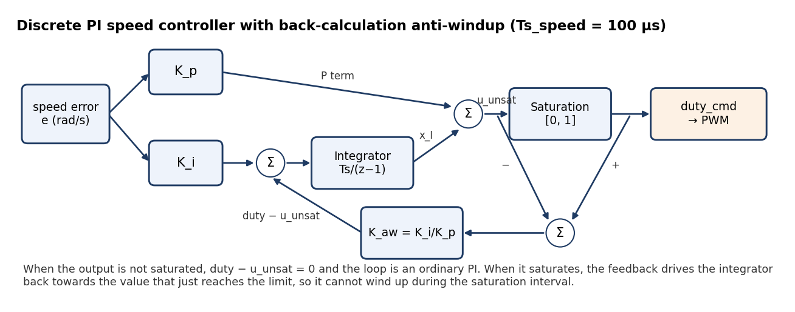

The controller runs at $T_s = 100\ \mu s$ and produces a normalized duty cycle:

$$u_{unsat}[k] = K_p e[k] + x_I[k], \qquad d[k] = \mathrm{sat}_{[0,\,1]}\big(u_{unsat}[k]\big)$$

$$x_I[k+1] = x_I[k] + T_s\Big(K_i e[k] + K_{aw}\big(d[k] - u_{unsat}[k]\big)\Big)$$

with $e = \omega_{ref} - \omega_{meas}$ in rad/s.

- **Output limits 0 … 1.** The command is a duty cycle. The lower limit is 0 because this inverter has no braking mode; a negative command has no physical meaning here.
- **Anti-windup (back-calculation).** While the output is inside its limits, $d - u_{unsat} = 0$ and the controller is a plain PI. When the output saturates, the difference drives the integrator back towards the value that just reaches the limit. $K_{aw} = K_i/K_p$ (tracking time constant $T_t = K_p/K_i = 4$ ms). Setting `antiWindupEnable = 0` removes this path, which is used in Test 4.
- **Soft start.** The speed reference is sampled at the controller rate and rate-limited to 30 000 rpm/s (0 → 1500 rpm in 50 ms). There is no inner current loop, so a hard reference step would draw a large starting current; the ramp limits the acceleration torque instead.

### Tuning

`design_speed_controller.m` averages the drive over one PWM period and one commutation sector. With two phases in series the motor then behaves like a DC motor fed with $D\cdot V_{dc}$:

$$G(s) = \frac{\omega_m(s)}{D(s)} = \frac{V_{dc} K_t}{(2L_s s + 2R_s)(Js + B) + K_t K_e}$$

With the parameters above, the plant has a static gain of about 190 (rad/s) per unit duty and a lightly damped electromechanical pole pair at −129 ± j382 rad/s (ωₙ ≈ 403 rad/s, ζ ≈ 0.32). The script evaluates the open-loop frequency response (including a 150 µs delay for sampling and PWM) and an unsaturated step response of this linear model for several gain pairs:

| Kp | Ki | Crossover | Phase margin | Gain margin | Overshoot (linear model) |
|---|---|---|---|---|---|
| 0 | 0.5 | ≈100 rad/s | ≈80° | ≈8 dB | ≈0 % |
| 0.002 | 0.3 | ≈63 rad/s | ≈106° | ≈23 dB | 0 % (slower) |
| **0.002** | **0.5** | **≈110 rad/s** | **≈102°** | **≈17 dB** | **0 %** |
| 0.002 | 0.8 | ≈224 rad/s | ≈90° | ≈10 dB | ≈3 % |
| 0.004 | 0.5 | ≈459 rad/s | ≈49° | ≈18 dB | 0 % |
| 0.004 | 1.0 | ≈477 rad/s | ≈31° | ≈11 dB | ≈7 % |

What the sweep shows:

- The voltage-fed motor is already a fairly "stiff" speed source (back-EMF feedback), so the **integral term does most of the work**. It removes the steady-state error that remains with proportional control alone; with Kp = 0.002 alone, the linear model settles at only about 28 % of the reference because $K_p G(0) \approx 0.38$.
- Increasing **Ki** speeds up the response, but above roughly 0.8 the crossover approaches the electromechanical resonance and overshoot appears.
- A **small Kp** adds damping and raises the gain margin (8 → 17 dB at Ki = 0.5) without slowing the response. Larger Kp (≥ 0.004) pushes the crossover up to the resonance and the phase margin drops below 50°.

**Kp = 0.002 (rad/s)⁻¹ and Ki = 0.5 (rad/s·s)⁻¹** were kept as a well-damped compromise and then checked in the switching Simulink model (Tests 1–3). The margins are properties of the averaged linear model only; commutation, PWM and saturation are not part of it.

---

## Simulation Scenarios

All scenarios use a light base load of 0.2 N·m, applied from t = 0 as an ideal torque source. Because this load does not depend on speed, it pulls the stationary rotor slightly backwards (about 1 rpm) during the first milliseconds, before the PI has built up motor torque. The sanity checks allow for this reverse creep (limit 5 rpm).

| Test | Description | Duration |
|---|---|---|
| 1 – Startup | Reference 0 → 1500 rpm at t = 0 (ramped) | 0.3 s |
| 2 – Load disturbance | Steady 1500 rpm, load +1 N·m at t = 0.25 s | 0.5 s |
| 3 – Reference change | 0 → 1000 rpm at t = 0, 1000 → 1500 rpm at t = 0.25 s | 0.5 s |
| 4 – Anti-windup | 1500 → 1000 rpm at t = 0.3 s, once without and once with anti-windup | 0.8 s |

Test 4 uses a speed *reduction* on purpose. Because the duty cannot go below 0, the motor can only coast down on friction and load, so the controller saturates for a long time. This is the case in which a PI without anti-windup keeps integrating the negative error.

### Metric definitions

- **Rise time:** 10 % → 90 % of the set-point change. In Test 1 it is dominated by the 50 ms reference ramp.
- **Overshoot:** peak above the final value, in % of the set-point change.
- **Settling time:** last time the speed is outside ±2 % of the set-point change.
- **Steady-state error:** mean speed error over the last 30–50 ms of the interval.
- **Load recovery time:** last time the speed is outside ±0.5 % of the reference after the load step.
- **Time at duty limit:** total time the duty command sits at its lower limit after the reference change.

All metrics are computed from the logged data in `analyze_results.m`. `stepinfo` is not used, because the responses include ramps, load steps and saturation.

---

## Results

The table and check list between the markers below are written automatically by `run_simulations.m` from the logged simulation data. Run the script to generate or refresh them.

<!-- RESULTS_TABLE_START -->
| Test | Metric | Result | Unit |
|------|--------|--------|------|
| Startup | Rise time (10-90 %) | 47.73 | ms |
| Startup | Overshoot | 0.141 | % |
| Startup | Settling time (2 % band) | 76.94 | ms |
| Startup | Steady-state speed error | -0.065 | rpm |
| Startup | Peak phase current | 4.33 | A |
| Startup | Peak electromagnetic torque | 3.63 | N*m |
| Startup | Steady-state torque | 0.355 | N*m |
| Startup | RMS phase current (steady state) | 0.366 | A |
| Load step | Maximum speed drop | 22.53 | rpm |
| Load step | Time to maximum drop | 4.85 | ms |
| Load step | Recovery time (+/-0.5 % band) | 20.13 | ms |
| Load step | Steady-state speed error after step | 0.012 | rpm |
| Load step | Mean torque before step | 0.350 | N*m |
| Load step | Mean torque after step | 1.36 | N*m |
| Load step | RMS phase current before step | 0.361 | A |
| Load step | RMS phase current after step | 1.36 | A |
| Load step | Effective torque constant after step | 0.835 | N*m/A |
| Reference change | 0 -> 1000 rpm: rise time | 38.01 | ms |
| Reference change | 0 -> 1000 rpm: overshoot | 0.279 | % |
| Reference change | 0 -> 1000 rpm: settling time | 63.31 | ms |
| Reference change | 0 -> 1000 rpm: steady-state error | 0.050 | rpm |
| Reference change | 1000 -> 1500 rpm: rise time | 27.35 | ms |
| Reference change | 1000 -> 1500 rpm: overshoot | 0.444 | % |
| Reference change | 1000 -> 1500 rpm: settling time | 45.64 | ms |
| Reference change | 1000 -> 1500 rpm: steady-state error | 0.025 | rpm |
| Anti-windup | Undershoot below 1000 rpm, without anti-windup | 343 | rpm |
| Anti-windup | Time at duty limit, without anti-windup | 172 | ms |
| Anti-windup | Minimum integrator state, without anti-windup | -0.703 | - |
| Anti-windup | Settling time (2 % of step), without anti-windup | 310 | ms |
| Anti-windup | Undershoot below 1000 rpm, with anti-windup | 205 | rpm |
| Anti-windup | Time at duty limit, with anti-windup | 88.20 | ms |
| Anti-windup | Minimum integrator state, with anti-windup | 0.000 | - |
| Anti-windup | Settling time (2 % of step), with anti-windup | 254 | ms |

**Sanity checks**

- **PASS** Speed reaches the 1500 rpm reference (|error| < 0.5 %) (error = -0.07 rpm)
- **PASS** Rotor turns in the commanded direction (reverse creep at start < 5 rpm) (min speed = -0.99 rpm)
- **PASS** DC-link voltage equals Vdc (polarity check) (mean v_dc = 160.0 V)
- **PASS** Electromagnetic torque follows the load step (within 10 %) (torque increase = 1.005 N*m)
- **PASS** Phase current increases with load (0.361 A -> 1.360 A rms)
- **PASS** Torque per ampere matches Kt = 2*p*lambda within 5 % (correct commutation alignment) (0.835 N*m/A vs 0.840 N*m/A)
- **PASS** Load step causes a temporary dip that the PI removes (dip 22.5 rpm, final error 0.01 rpm)
- **PASS** Anti-windup reduces the undershoot after saturation (343.2 rpm -> 205.3 rpm)
- **PASS** All logged signals are finite (no NaN/Inf) in every run (0 non-finite samples)
- **PASS** Duty command stays within its saturation limits (range 0.000 ... 0.861)
- **PASS** Only legal Hall states (001...110) occur while rotating (285710 samples, 0 illegal)
- **PASS** Hall states advance in the order 5-4-6-2-3-1 (no skipped or reversed steps) (1400 forward transitions, 0 other)
- **PASS** No leg has its upper and lower switch on together (0 of 2900005 gate samples)
- **PASS** At most one upper and one lower switch conduct at a time (0 of 2900005 gate samples)
<!-- RESULTS_TABLE_END -->

### Figures

| | |
|---|---|
| 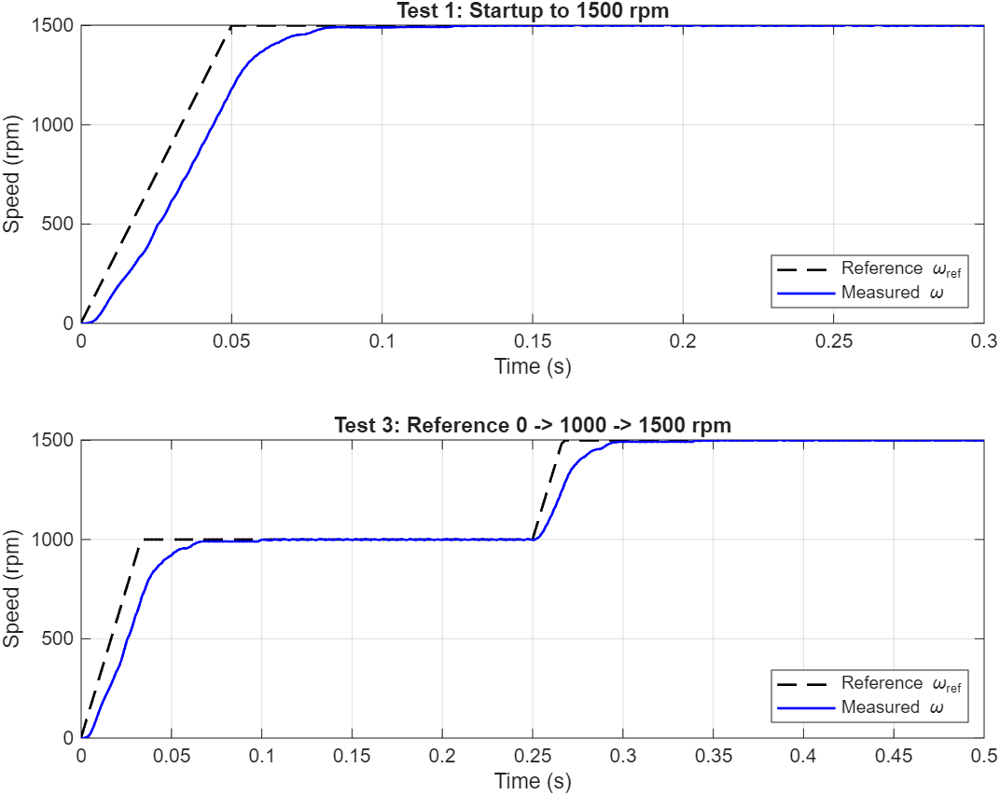 | 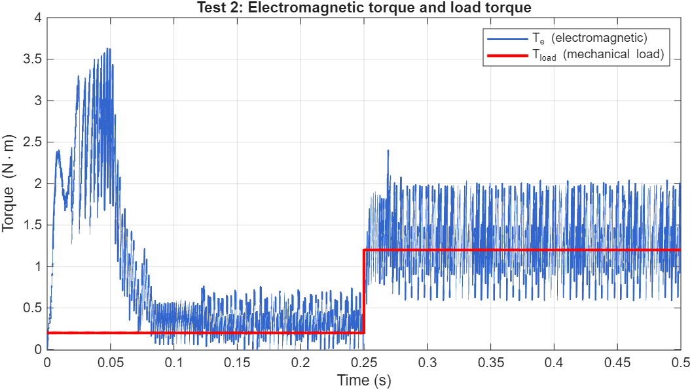 |
| Fig. 1 – Reference and measured speed (Tests 1 and 3) | Fig. 2 – Electromagnetic and load torque (Test 2) |
| 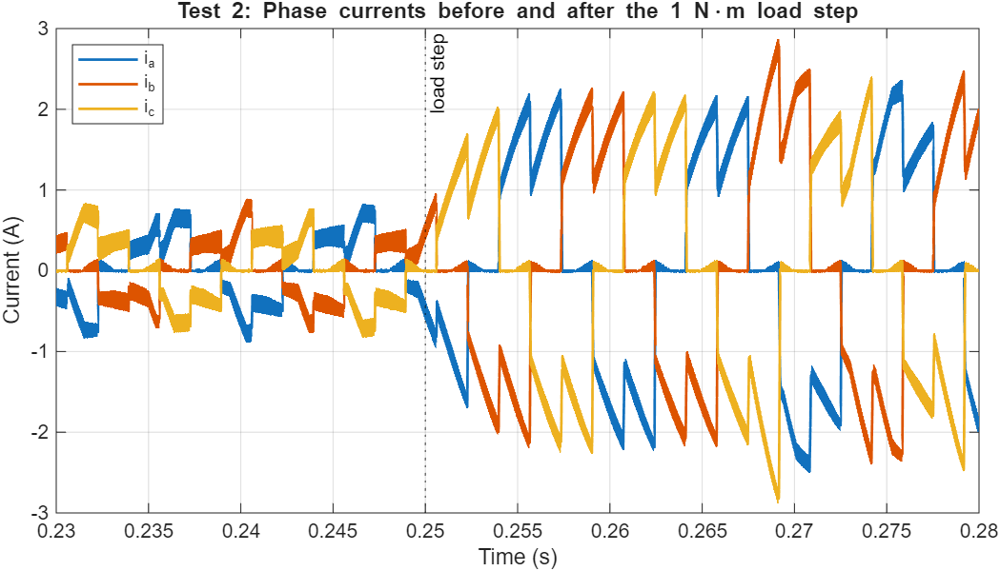 | 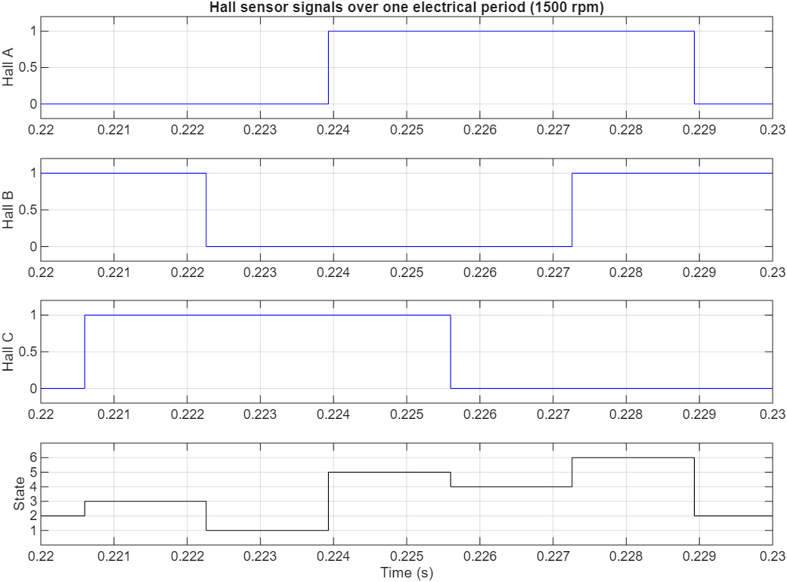 |
| Fig. 3 – Phase currents around the load step | Fig. 4 – Hall signals and Hall state over one electrical period |
| 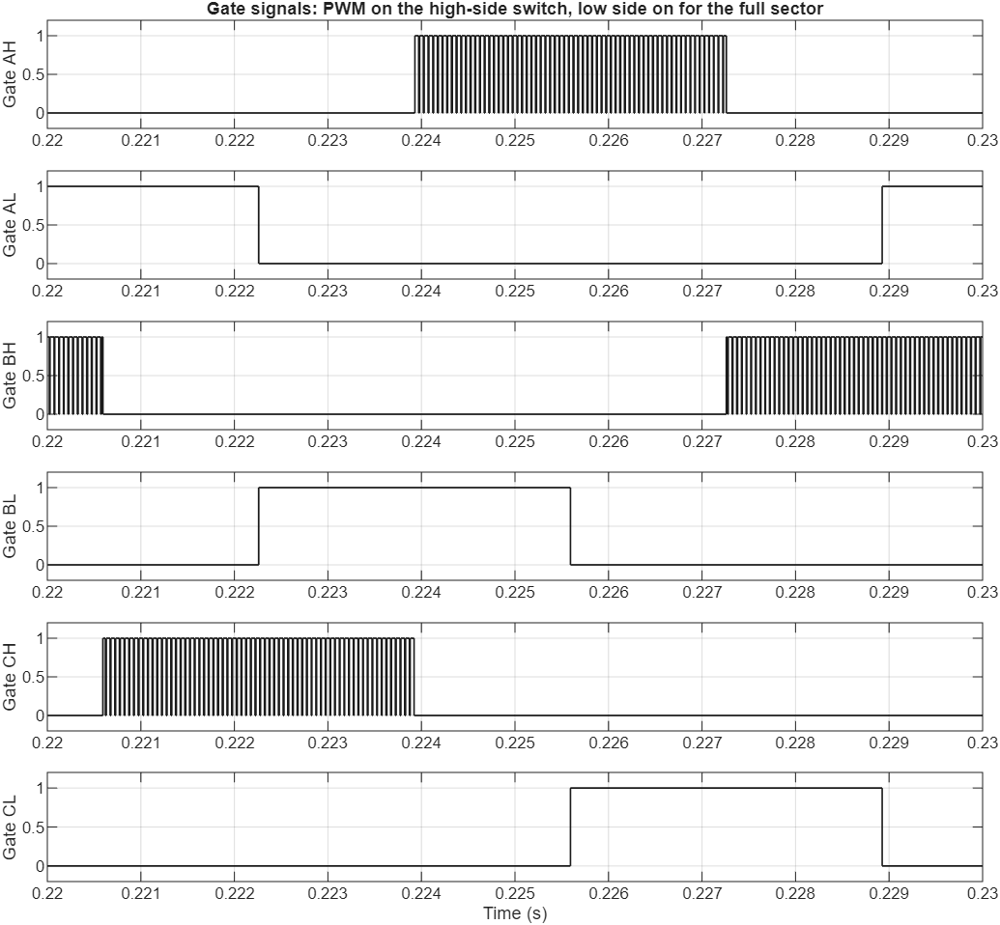 | 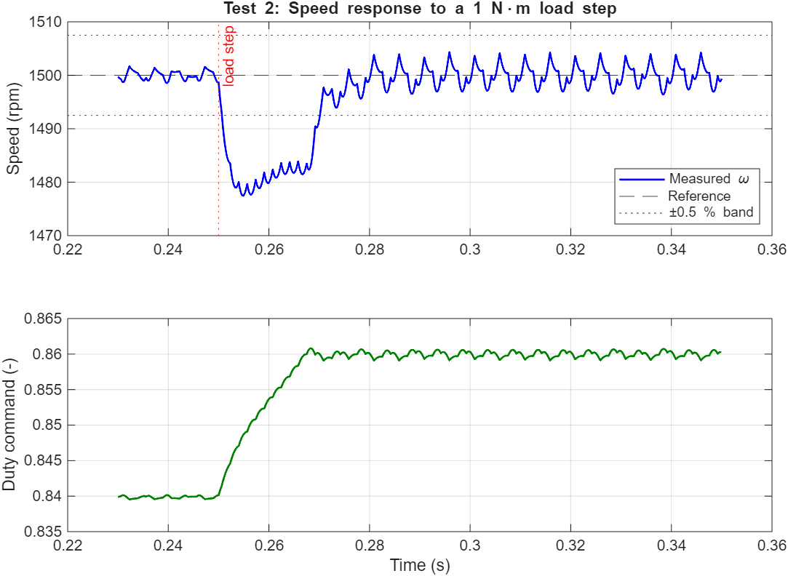 |
| Fig. 5 – Gate signals (PWM on the high side) | Fig. 6 – Speed dip and duty response to the load step |
| 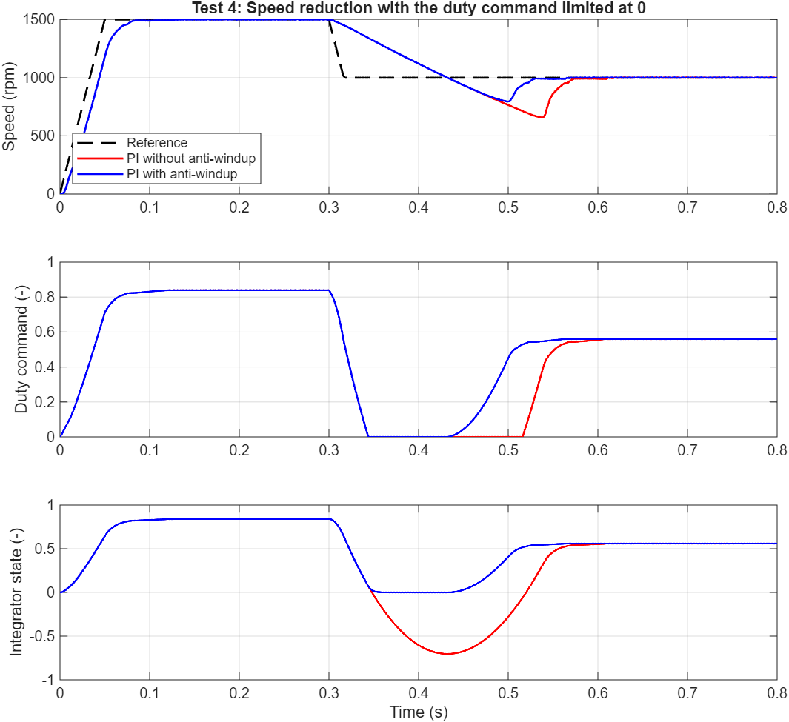 | 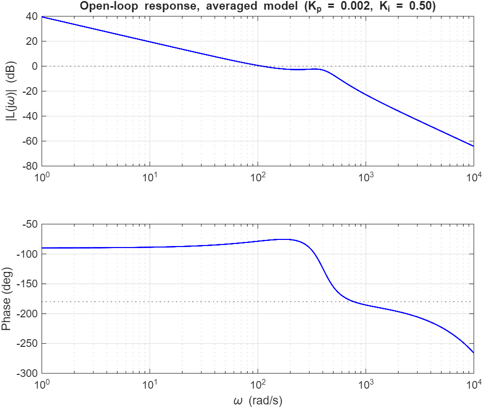 |
| Fig. 7 – Speed reduction with and without anti-windup | Fig. 0 – Open-loop response of the averaged model |

### Discussion of the results

- **Startup (Test 1):** the speed follows the 50 ms reference ramp with a lag and settles in about 77 ms. Overshoot is 0.14 % and the peak phase current is 4.3 A. The rise time (≈48 ms) is set mainly by the ramp.
- **Load step (Test 2):** a 1 N·m load step causes a 22.5 rpm dip, and the speed is back inside ±0.5 % after about 20 ms. Mean torque rises by 1.005 N·m and RMS phase current rises from 0.36 A to 1.36 A. The measured torque per ampere is 0.835 N·m/A, against a theoretical 0.84 N·m/A.
- **Reference change (Test 3):** both steps settle within 64 ms with less than 0.5 % overshoot and a steady-state error below 0.1 rpm.
- **Anti-windup (Test 4):** without anti-windup the integrator winds down to −0.70. The duty stays at 0 for 172 ms and the speed undershoots 1000 rpm by 343 rpm. With back-calculation the integrator stays near 0, the time at the limit falls to 88 ms and the undershoot to 205 rpm. An undershoot remains even with anti-windup: the inverter cannot brake, and the integrator must rebuild about 0.55 duty after the speed crosses the new reference.
- **Torque ripple:** six-step commutation with a 3.9 ms electrical time constant causes significant torque ripple (Fig. 2). This is expected for this drive type and is not compensated.

---

## Repository Structure

```text
BLDC-Motor-Drive/
├── README.md
├── LICENSE
├── .gitignore
├── model/
│   └── BLDC_ClosedLoop.slx          # created by build_bldc_model.m
├── scripts/
│   ├── parameters.m                  # all numerical parameters (SI units)
│   ├── build_bldc_model.m            # builds the Simulink model programmatically
│   ├── design_speed_controller.m     # averaged-model PI tuning, Fig. 0
│   ├── run_simulations.m             # runs Tests 1-4, metrics, checks, figures
│   ├── analyze_results.m             # metric calculation and sanity checks
│   ├── plot_results.m                # result figures
│   ├── smoke_test.m                  # 60 ms start-up run with basic checks
│   ├── verify_gate_mapping.m         # Universal Bridge gate-order test bench (PASS/FAIL)
│   └── validate_project.m            # checks files, model compile, results
├── results/
│   ├── figures/                      # fig0 ... fig7 (PNG)
│   └── metrics/                      # metrics_summary.csv / .md
└── docs/
    ├── system_architecture.png
    ├── speed_controller.png
    └── simulink_model.png            # top-level Simulink model screenshot
```

## Requirements

- MATLAB R2025a
- Simulink
- Simscape and Simscape Electrical (Specialized Power Systems library `sps_lib`)

`design_speed_controller.m` uses base MATLAB only.

## Running the Project

From the repository root:

```matlab
addpath('scripts');
build_bldc_model;          % creates model/BLDC_ClosedLoop.slx
design_speed_controller;   % averaged-model PI analysis, Fig. 0
run_simulations;           % Tests 1-4, metrics, figures, README table
validate_project;          % errors if any check fails
```

Optional:

```matlab
verify_gate_mapping;       % PASS/FAIL check of the Universal Bridge gate order
```

`verify_gate_mapping` independently checks the Universal Bridge gate-vector mapping `[AH AL BH BL CH CL]` on a temporary resistive-load test bench; it does not need the drive model.

`smoke_test` can be run on its own after `build_bldc_model` as a quick (≈15 s) check. The full scenario run takes a few minutes.

## Engineering Takeaways

- With Hall sensors and a two-input-per-phase decoder ($c_x = H_x - H_{x+1}$), six-step commutation needs no lookup table, and illegal Hall states switch the bridge off naturally.
- Commutation must be checked on the full chain, from Hall decoder through gate order and bridge to motor phases. A wrong phase mapping can still turn the motor, so torque per ampere is a useful extra check.
- A voltage-fed BLDC motor behaves like a DC motor in the averaged sense, which is enough to choose PI gains. The switching simulation then confirms them.
- Without a current loop, the speed-reference ramp is what limits the starting current.
- When the actuator can only drive and not brake, anti-windup shortens saturation and reduces undershoot, but it cannot remove the undershoot completely.
